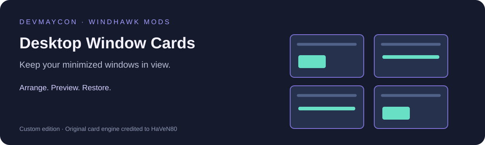

# Desktop Window Cards — DevMaycon

*Original project illustration.*

**Turn minimized windows into an organized desktop workspace.**

Customized for DevMaycon with Codex assistance. This edition provides
animated preview cards with its own defaults, settings refactoring, and guide.

## Quick start

1. Keep the original Desktop Window Cards disabled and enable this edition.
2. Minimize a window to place its preview card on the desktop.
3. Click the preview to restore the window.
4. Drag the title bar to reposition or reorder a card.
5. Hold **Shift** while minimizing to skip that card.

## This edition's defaults

| Option | Initial value |
| --- | --- |
| Layout | Grid, arranged per monitor |
| Maximum grid card width | 560 pixels at 100% scaling |
| Fall animation | 320 milliseconds |
| Close button | Dismisses the card; keeps the application open |
| Existing minimized windows | Not collected when enabling the mod |
| Game exclusions | VALORANT-Win64-Shipping.exe, cs2.exe, cod.exe |

All options remain editable in **Details > Settings**. Exclusions match
executable names or paths; add the correct name if your installation differs.

## Workspace interactions

**Restore:** click a preview, or restore the application normally from the taskbar.
**Reorder:** drag a title bar across another card while using grid layout.
**Move between monitors:** drag a card to the destination monitor.
**Drag and drop:** hold a file over a card to restore its window for dropping.
**Virtual desktops:** cards follow the desktop of their source window.
**Hover:** cards brighten and optionally grow when the pointer enters them.

Cards use Windows DWM previews. A minimized application may stop updating
its image, leaving its last frame visible. Elevated windows can restrict
restore/close commands. Apps that hide to the tray may not create a card.

## Project-specific refactoring

- Complete settings snapshots instead of incremental configuration changes.
- Scoped ownership of settings strings.
- Trimmed, normalized, and deduplicated application exclusions.
- Separate local mod identity and window class names.
- Worker initialization checks and cleanup after failed waits.

The host runs separately from Explorer. This edition does not change game
priorities or anti-cheat. Native animation behavior remains configurable.

## Validation and project files

The 32-bit and 64-bit builds compiled successfully. Fourteen settings tests
passed. The integration test created a visible 560 x 376 card when the test
window was minimized and removed it when that window was restored.
Card-click restoration, drag-and-drop, multiple monitors, and virtual desktop
switching were not separately exercised during that session.

- `maycon-desktop-window-cards.wh.cpp` — editable source and settings.
- `test-maycon-desktop-cards.cpp` — configuration tests.
- `card-preview-test.cpp` — our isolated test window.
- `card-state-diagnostic.cpp` — read-only integration probe.
- `docs/VALIDATION.md` — recorded integration results and test limits.
- `LICENSE` — the applicable GPL license.

## Disable or restore

Disable this edition in Windhawk to remove its cards without closing apps.
The original mod remains separately installed and disabled. Do not run both
editions together. Large icons is a separate project and remains independent.

## Version 1.0.1

DevMaycon branding and an original English guide based on this project's
files and recorded tests. No third-party promotional images are embedded.
Existing user settings and card engine behavior are preserved.

## Credits and links

Original card engine: **HaVeN80**, Desktop Window Cards 1.8. This edition is a derivative work under **GPL-3.0-only**; customization does not claim authorship of the original engine. [Upstream reference](https://github.com/ramensoftware/windhawk-mods/blob/15eab1d96589bcbec11e4d9e8aeb2659510e1206/mods/desktop-window-cards.wh.cpp).

- Custom edition and maintenance: **DevMaycon**.
- Development assistance: **OpenAI Codex**.
- Repository: [MayconDIS/Windhawk_Mods](https://github.com/MayconDIS/Windhawk_Mods).
- GitHub profile: [MayconDIS](https://github.com/MayconDIS).
