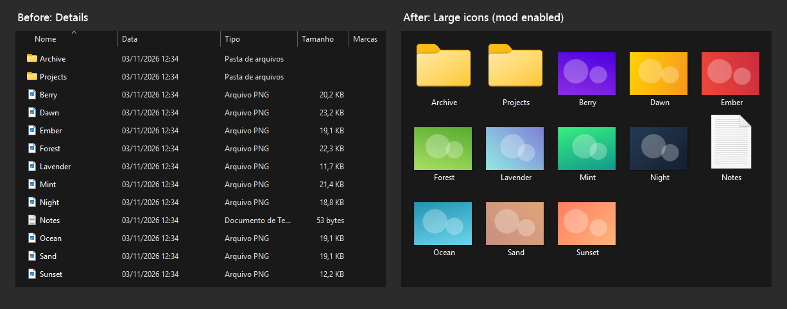

# Large Icons View for File Explorer

Keeps File Explorer folders in **Large icons** view. The icon size is
configurable: 96 pixels matches Windows' own Large icons.

## How it works

The view is switched when a folder opens in a File Explorer window, without
waiting or polling.

- **Keep enforcing** (default): if you switch a folder to another view, it is
  switched back to large icons.
- With **Keep enforcing** off, every folder opens in large icons, but a view
  you pick manually stays until you navigate to another folder.

It applies to file-system folders (local, removable and network drives). The
desktop, Open/Save dialogs, Home, This PC, the Recycle Bin and other virtual
folders are not affected. Folder contents are never read, moved or changed.

## Disabling the mod and restoring views

When *Remember each folder's view settings* is on (the Windows default),
Explorer saves the view of each folder you open. Every folder opened while the
mod is enabled is therefore saved in large icons, and keeps that view after the
mod is disabled or removed.

To restore the default view of all folders, open **Folder Options > View** and
select **Reset Folders**.

## Credits and links

Original project by **Dev_Maycon**, developed with AI assistance. Licensed
under **GPL-3.0-only**.

- Repository: [MayconDIS/Windhawk_Mods](https://github.com/MayconDIS/Windhawk_Mods).
- GitHub profile: [MayconDIS](https://github.com/MayconDIS).
